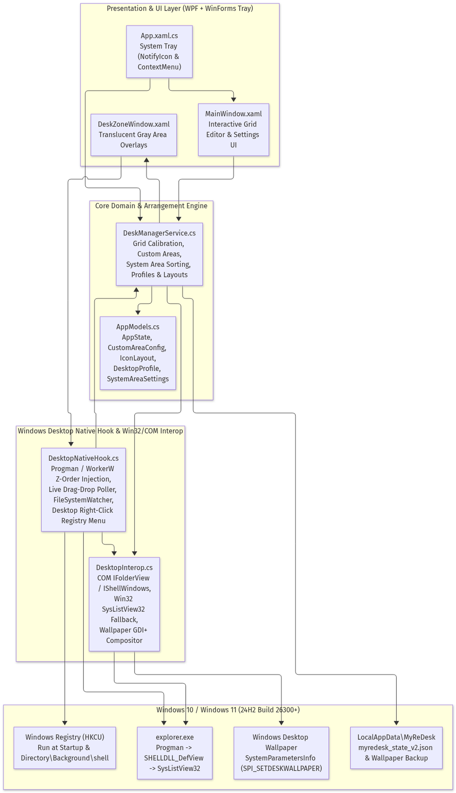

# DesktopOrg — Technical Architecture & Windows 11 24H2 Engineering Guide

This document details the internal architecture of **DesktopOrg**, focusing on how it hooks into the Windows Desktop (`Progman` / `SHELLDLL_DefView` / `SysListView32`), handles multi-monitor setups with mixed DPIs and negative coordinates, prevents Windows Explorer grid-collision bumping, and organizes desktop icons into per-monitor Gray Boxes and 3-way column groups.

---

## 1. High-Level Component Architecture

*(Mermaid source: [`diagrams/01_system_architecture.mmd`](./diagrams/01_system_architecture.mmd))*

| Layer | File | Responsibilities |
| :--- | :--- | :--- |
| **Application & Tray Host** | [`App.xaml.cs`](../App.xaml.cs) | Single-instance mutex (`Local\DesktopOrg_SingleInstance_Mutex_v2`), cross-process `EventWaitHandle` activation (`ShowWindowEventName`, `PopupMenuEventName`), `System.Windows.Forms.NotifyIcon` tray icon (`Assets/DesktopOrg.ico`) & hierarchical monitor context menu, native cursor popup host (`ShowPopupMenuAtCursor`), 500ms overlay & Virtual Desktop keep-alive timer (`EnsureVisibleOnDesktop()`), and `SystemEvents.DisplaySettingsChanged` listener. |
| **Settings & Interactive Grid UI** | [`MainWindow.xaml`](../MainWindow.xaml), [`MainWindow.xaml.cs`](../MainWindow.xaml.cs) | Interactive 2D Desktop Layout Preview canvas (color-coded dots: Blue = App Shortcuts, Orange = Folders/Files, Purple = Internet Shortcuts `.url`), Multi-Monitor `Target Screen` selector, Quick-Add / Delete / Preset Gray Box controls, 3-Group Main Desktop sorting controls, and circular `?` hover tooltips (`HelpCircleBadge`). |
| **Desktop Gray Box Overlays** | [`Views/DeskZoneWindow.xaml`](../Views/DeskZoneWindow.xaml), [`Views/DeskZoneWindow.xaml.cs`](../Views/DeskZoneWindow.xaml.cs) | Translucent (`AllowsTransparency="True"`, `WS_EX_LAYERED`) rounded gray box windows owned by `Progman` (`GWLP_HWNDPARENT = -8`), DPI-calibrated via `GetDpiForWindow(hwnd)`, supporting both locked click-through mode (`WS_EX_TRANSPARENT | WS_EX_NOACTIVATE`) and unlocked interactive drag/resize across monitors. |
| **Core Arrangement Engine** | [`Services/DeskManagerService.cs`](../Services/DeskManagerService.cs) | Grid calibration (`CalibrateDesktopGrid`), Multi-Monitor origin math (`GetMonitorOrigins`), per-monitor icon attribution (`FindMonitorForListViewPoint`), 6-pass `ApplyAndSaveChange` arrangement engine, 3-group System Area column separator (`ArrangeSystemAreaIcons`), per-monitor-topology layout memory (`TryAutoRestoreForCurrentMonitors`), Undo/Backup snapshots, and workspace profiles. |
| **Win32 & COM Shell Interop** | [`Services/DesktopInterop.cs`](../Services/DesktopInterop.cs) | STA COM thread accessing `IShellWindows` -> `IShellBrowser` -> `IFolderView` -> `IShellFolder` to read/write desktop icon positions (`SelectAndPositionItems` 2-pass), 64-bit cross-process `SysListView32` (`VirtualAllocEx` / `ReadProcessMemory`) fallback, hardware EDID monitor name lookup (`QueryDisplayConfig` / `DisplayConfigGetDeviceInfo`), Virtual Desktop discovery, `.url` vs `.lnk` vs Folder classification, shell icon extraction (`SHGetFileInfo`), and GDI+ Wallpaper integration. |
| **Native Desktop Hook** | [`Services/DesktopNativeHook.cs`](../Services/DesktopNativeHook.cs) | Live 350ms desktop icon drag-drop poller (guarded by `GetAsyncKeyState(VK_LBUTTON)` and `_service.IsApplyingInternalChange`), `FileSystemWatcher` on User & Public Desktops, and `HKCU\Software\Classes\Directory\Background\shell\DesktopOrg` cascading right-click menu synchronization. |
| **Domain Models** | [`Models/AppModels.cs`](../Models/AppModels.cs) | Serializable state (`AppState`, `CustomAreaConfig`, `SystemAreaSettings`, `DesktopIconItem`, `IconLayout`, `DesktopProfile`, `MonitorInfo`, `MonitorMenuCache`, `VirtualDesktopInfo`) persisted to `%LocalAppData%\DesktopOrg\desktoporg_state_v2.json` (with automatic migration from `%LocalAppData%\MyReDesk\myredesk_state_v2.json`). |

---

## 2. Windows 11 24H2 Desktop Hook & High-DPI Multi-Monitor Overlays

*(Mermaid source: [`diagrams/02_windows_desktop_hook.mmd`](./diagrams/02_windows_desktop_hook.mmd))*

### 2.1 Why Legacy Desktop Overlays Fail on Windows 11 24H2
1. **`WS_CHILD` + `SetParent(hwnd, progman)` breaks WPF `AllowsTransparency="True"`**:
   - WPF windows with `AllowsTransparency="True"` rely on `WS_EX_LAYERED` + `UpdateLayeredWindow`. Converting a top-level WPF window into a `WS_CHILD` window disables per-pixel alpha rendering in DWM, causing the window to become invisible.
2. **`SetWindowPos(hwnd, HWND_BOTTOM, ...)` pushes windows behind `Progman`**:
   - Calling `SetWindowPos` with `HWND_BOTTOM` places an unowned popup window *behind* `Progman` (behind the opaque desktop wallpaper), hiding it from view.
3. **Per-Monitor DPI Scaling (`125%` / `150%`) shifts WPF DIP Coordinates**:
   - On a multi-monitor setup where the primary monitor runs at `125%` DPI (`120 DPI`), setting WPF `Left = 2440` in Device-Independent Pixels (DIPs) causes Windows to multiply `2440 * 1.25 = 3050` physical pixels, pushing the Gray Box off the right edge of the monitor onto an adjacent display.

### 2.2 How [`DeskZoneWindow.xaml.cs`](../Views/DeskZoneWindow.xaml.cs) Solves All Three
1. **`Progman` Window Ownership (`GWLP_HWNDPARENT = -8`)**:
   - In `OnSourceInitialized`, `DeskZoneWindow` finds `Progman` (`FindWindow("Progman", null)`) and sets `Progman` as its **Owner** via `SetWindowLongPtr(hwnd, GWLP_HWNDPARENT, progman)`.
   - In Win32 window management, an owned popup window is **guaranteed to stay in front of its owner (`Progman` wallpaper)**, **behind normal application windows**, and **never minimizes when the user presses `Win + D` (Show Desktop)**.
2. **Two-Step Per-Monitor DPI Calibration (`GetDpiForWindow`)**:
   - In `ApplyAreaToUi()`, `DeskZoneWindow` first moves the `HWND` to the target monitor's physical pixel coordinates `(pxX, pxY)` via `SetWindowPos`, then queries `GetDpiForWindow(hwnd)` (`scale = dpi / 96.0`), updates WPF's `Left = pxX / scale`, `Top = pxY / scale`, `Width = finalPxW / scale`, `Height = finalPxH / scale` so `UpdateLayeredWindow` renders the exact bitmap size, and finally re-applies `SetWindowPos` with `SWP_NOZORDER | SWP_NOACTIVATE | SWP_SHOWWINDOW`.

### 2.3 Multi-Monitor Coordinate Translation (`VirtualScreen` vs. `Physical Screen`)
On multi-monitor setups where a secondary monitor sits to the left of the Primary Monitor (e.g., Left Monitor at `X = -1920, Y = 120`, Primary Monitor at `X = 0, Y = 0`):
- **Windows `SysListView32` (`IFolderView`)** in a `PerMonitorV2` DPI-aware process uses physical pixel coordinates relative to the top-left of the **Virtual Screen** (`Min(X) = -1920, Min(Y) = 0`), meaning the top-left of the Primary Monitor is at **`ListView X = +1920, Y = 0`**.
- **Top-Level Win32 Windows (`DeskZoneWindow`)** use **Physical Screen** coordinates, meaning the top-left of the Primary Monitor is at **`Screen X = 0, Y = 0`**.
- [`DesktopInterop.GetTargetMonitorListViewOrigin()`](../Services/DesktopInterop.cs) and [`DeskManagerService.GetMonitorOrigins()`](../Services/DeskManagerService.cs) compute `ListViewOrigin = (target.X - rawMinX, target.Y - rawMinY)` and `ScreenOrigin = (target.X, target.Y)` without dividing by DPI scale factors, and [`DeskManagerService.FindMonitorForListViewPoint()`](../Services/DeskManagerService.cs) checks strict non-overlapping monitor bounds first so Column 0 icons on the Primary Monitor are never misattributed to an adjacent monitor.

---

## 3. Three-Group Icon Organization Pipeline & Collision-Free Grid Placement

*(Mermaid source: [`diagrams/03_icon_organization_pipeline.mmd`](./diagrams/03_icon_organization_pipeline.mmd))*

When `ApplyAndSaveChange()` runs in [`DeskManagerService.cs`](../Services/DeskManagerService.cs):

1. **WorkArea Grid Calibration (`CalibrateDesktopGrid`)**:
   - Queries `LVM_GETITEMSPACING` from `SysListView32` (e.g., `76×113` px) and calculates `GridCols` and `GridRows` using each monitor's `WorkHeight` minus a bottom label margin (`CellHeightPx / 3`). On a `3440×1440` monitor, this yields **`45×11` cells (`Rows 0..10`)**, preventing Windows Explorer from rejecting or bumping icons placed too close to the taskbar.
2. **Custom Gray Box Assignment (Passes 1–3)**:
   - Reserves all grid cells covered by visible `CustomAreas` on each monitor.
   - Claims icons physically dropped inside a Gray Box (`Pass 1`) or matching a Gray Box's `AutoRule` (`Pass 2`: `Folders & Files`, `Web Links (.url)`, `Folders`, `Shortcuts`, `Documents`, `Media`, `Code & Archives`), and snaps them into that box's internal grid (`Pass 3`).
3. **3-Group Main Desktop Separation (`Pass 4 — ArrangeSystemAreaIcons`)**:
   - Separates remaining icons into 3 distinct column groups with an optional **1-column empty gap** (`colGap = LeaveEmptyColumnBetweenGroups ? 1 : 0`):
     - **Group A — System Icons & App Shortcuts (`.lnk`, `.exe`, `.appref-ms`)**: Placed starting at `Col 0`.
     - **Group B — Folders & Local Files (`.pdf`, `.epub`, `.txt`, `.bat`, `.ps1`, Folders)**: Placed starting at `lastShortcutCol + 1 + colGap`.
     - **Group C — Internet Shortcuts (`.url`)**: Placed starting at `lastFileCol + 1 + colGap` (or grouped with Files or Shortcuts per `WebLinksGroupMode`), sorted by `Domain (A-Z)`, `Domain (Most Links First)`, `Name (A-Z)`, or `Date Modified`.
4. **Two-Pass `IFolderView::SelectAndPositionItems` (`Pass 5`)**:
   - [`DesktopInterop.SetPositionsViaFolderView()`](../Services/DesktopInterop.cs) executes `SelectAndPositionItems` in **two passes separated by 35ms**, ensuring Pass 2 snaps every icon into its exact target cell once old cells are vacated.

---

## 4. Live Desktop Watcher & Loop-Free State Synchronization

*(Mermaid source: [`diagrams/04_live_desktop_watcher_sequence.mmd`](./diagrams/04_live_desktop_watcher_sequence.mmd))*

- [`DeskManagerService`](../Services/DeskManagerService.cs) sets `IsApplyingInternalChange = true` during `ApplyAndSaveChange()`, `RestoreUndoSnapshot()`, and `RestoreLayout()`, and fires `InternalChangeCompleted` in a `finally` block.
- [`DesktopNativeHook`](../Services/DesktopNativeHook.cs) ignores all file/position changes while `IsApplyingInternalChange` is `true` and immediately refreshes its baseline icon map (`CaptureBaselineIconPositions()`) when `InternalChangeCompleted` fires—ensuring `Undo` and `Restore` never trigger a self-rearrange loop.

---

## 5. Multi-Monitor Gray Boxes, Per-Topology Layout Memory, Hierarchical Menus & Virtual Desktops

### 5.1 Hardware Monitor Friendly Name Generation (`QueryDisplayConfig`)
- [`DesktopInterop.GetMonitorHardwareFriendlyNames()`](../Services/DesktopInterop.cs) calls Win32 `GetDisplayConfigBufferSizes(QDC_ONLY_ACTIVE_PATHS)`, `QueryDisplayConfig`, and `DisplayConfigGetDeviceInfo` (`DISPLAYCONFIG_DEVICE_INFO_GET_SOURCE_NAME` + `DISPLAYCONFIG_DEVICE_INFO_GET_TARGET_NAME`) to map each GDI device name (`\\.\DISPLAY1`, `\\.\DISPLAY2`, etc.) to its EDID hardware model (e.g., `PHL 278E9Q`, `Z34B`).
- Combined with spatial ordering (left-to-right, top-to-bottom), `GetMonitors()` generates human-friendly names such as:
  - `Monitor 1: Left - PHL 278E9Q (1920x1080)`
  - `Monitor 2: Main - Z34B (3440x1440) [Primary]`
  - `Monitor 3: Right 1 - PHL 278E9Q (1920x1080)`
  - `Monitor 4: Right 2 (1536x864)`

### 5.2 Per-Monitor-Topology Layout Memory + Graceful Disconnect Fallback
- Every saved `IconLayout` stores `MonitorSignature` (encoding the connected display count, bounds, and primary flag), `Icons`, `SavedAreas`, and `SavedMonitorCaches`.
- Whenever `ApplyAndSaveChange()` runs, `UpsertActiveOrganizedLayout()` updates the `Active Organized Layout (<N> Displays)` snapshot for the current `MonitorSignature`.
- When `SystemEvents.DisplaySettingsChanged` fires (`TryAutoRestoreForCurrentMonitors()`):
  1. If `DisconnectedMonitorMode == "RememberSetupOrHide"` (default) and a saved layout matches the new `MonitorSignature` with `AutoRestoreOnMonitorMatch == true`, DesktopOrg restores that monitor configuration's `SavedAreas`, `SavedMonitorCaches`, and `Icons`.
  2. Otherwise, DesktopOrg falls back to hiding `DeskZoneWindow` overlays whose `MonitorDeviceName` is currently offline (`ResolveMonitorForArea(area) == null`) while preserving their `CustomAreaConfig` and `CachedItems` in `desktoporg_state_v2.json` and in the menus.

### 5.3 Hierarchical Monitor Menu & Bypassing Explorer's 16-Subkey Limit
- **System Tray Menu ([`App.RebuildTrayContextMenu()`](../App.xaml.cs))**:
  - Dynamically builds a `ToolStripMenuItem` tree grouped by each monitor (`GetAllMonitorsIncludingCachedOffline()`):
    - `Monitor Name` $\rightarrow$ `App Shortcuts (<count>)`, `Folders & Local Files (<count>)`, `Internet Shortcuts (.url) (<count>)` (sub-grouped by domain), and each `Gray Box: <Title> (<count>)` $\rightarrow$ clickable items with extracted shell icons (`DesktopInterop.ExtractIconBitmapSafe`).
- **Windows Desktop Right-Click Context Menu ([`DesktopNativeHook.SyncDesktopContextMenuRegistry()`](../Services/DesktopNativeHook.cs) & [`App.ShowPopupMenuAtCursor()`](../App.xaml.cs))**:
  - Windows Explorer (`shell32.dll` `CRegistryVerbsContextMenu`) enforces a hard limit of **16 total subkeys across an entire cascading registry tree** under `Directory\Background\shell\<Verb>\shell`; exceeding 16 subkeys causes Explorer to silently truncate subsequent submenus and monitors.
  - `SyncDesktopContextMenuRegistry()` keeps the total registry subkey count within `<= 15` keys (`Monitor` $\rightarrow$ `App Shortcuts`, `Folders & Local Files`, `Internet Shortcuts (.url)`, and `Gray Boxes`) and wires each verb to `"DesktopOrg.exe" --popup "mon:<device>|group:<Group>"`.
  - Clicking any group or Gray Box in the Windows Desktop context menu signals the running `DesktopOrg` tray instance via `Local\DesktopOrg_PopupMenu_Event_v2` to open `ShowPopupMenuAtCursor()` directly at `Cursor.Position` with unlimited items, domain sub-groups, and real file/application icons.

### 5.4 Windows 10/11 Virtual Desktop Filtering
- [`DesktopInterop.GetVirtualDesktops()`](../Services/DesktopInterop.cs) and `GetCurrentVirtualDesktopId()` read `HKCU\Software\Microsoft\Windows\CurrentVersion\Explorer\VirtualDesktops` (`VirtualDesktopIDs`, `CurrentVirtualDesktop`, and per-desktop `Name`).
- Each `CustomAreaConfig` has `VirtualDesktopId` (`"*"` for all virtual desktops, or a specific desktop GUID). The 500ms keep-alive timer in [`App.xaml.cs`](../App.xaml.cs) detects virtual desktop switches and immediately updates `DeskZoneWindow` visibility and the System Tray menu.
